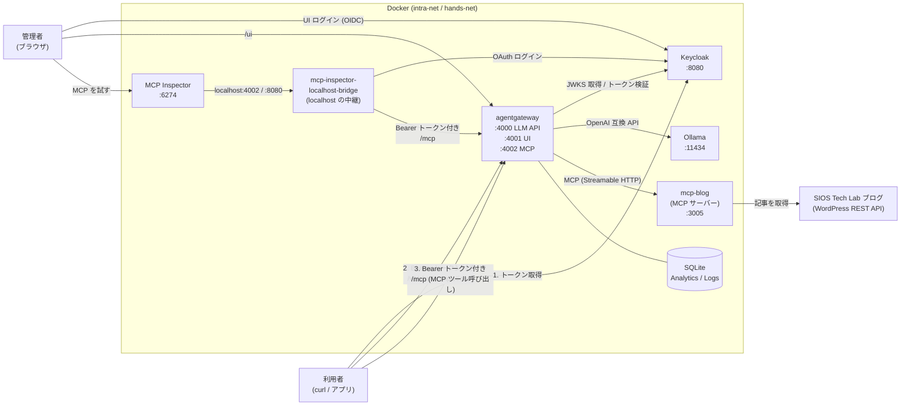

# OSS AI Gateway 体験: agentgateway with ローカル LLM, リモート MCP サーバー and Keycloak

[](https://github.com/Toshiharu-Konuma-sti/my-skilling/blob/main/LICENSE)
[](https://github.com/Toshiharu-Konuma-sti/my-skilling/commits/main)
[](https://www.docker.com/)
[](https://ollama.com/)
[](https://huggingface.co/)
[](https://agentgateway.dev/)
[](https://www.keycloak.org/)
[](https://openid.net/connect/)

## 目次

1. [はじめに](#1-はじめに)
2. [環境説明](#2-環境説明)
3. [環境構築](#3-環境構築)
   - [3-1. リポジトリ取得](#3-1-リポジトリ取得)
   - [3-2. モデルの事前ダウンロード](#3-2-モデルの事前ダウンロード)
   - [3-3. コンテナ構築](#3-3-コンテナ構築)
4. [体験](#4-体験)
   - [4-1. LLM を直接利用する](#4-1-llm-を直接利用する)
   - [4-2. LLM をゲートウェイ経由で利用する](#4-2-llm-をゲートウェイ経由で利用する)
     - [4-2-1. トークンなしで利用する](#4-2-1-トークンなしで利用する)
     - [4-2-2. Keycloak で発行したトークンで利用する](#4-2-2-keycloak-で発行したトークンで利用する)
     - [4-2-3. ロールによる認可を確認する](#4-2-3-ロールによる認可を確認する)
   - [4-3. リモート MCP サーバーをゲートウェイ経由で利用する](#4-3-リモート-mcp-サーバーをゲートウェイ経由で利用する)
     - [4-3-1. トークンなしで利用する](#4-3-1-トークンなしで利用する)
     - [4-3-2. Keycloak で発行したトークンで利用する](#4-3-2-keycloak-で発行したトークンで利用する)
     - [4-3-3. ロールによるツールの認可を確認する](#4-3-3-ロールによるツールの認可を確認する)
     - [4-3-4. MCP Inspector で利用する](#4-3-4-mcp-inspector-で利用する)
   - [4-4. 管理画面を SSO で利用する（Analytics / Logs）](#4-4-管理画面を-sso-で利用するanalytics--logs)
5. [設定ファイル](#5-設定ファイル)
6. [清掃手順](#6-清掃手順)
7. [Tips](#7-tips)

## 1. はじめに

[Ollama](https://ollama.com/) のローカル LLM を、AI Gateway の [agentgateway](https://agentgateway.dev/) 経由で公開し、IdP の [Keycloak](https://www.keycloak.org/) で「LLM 利用者の認証・認可」と「管理 UI の SSO」を体験するための環境です。

SaaS の LLM や外部の IdP を一切使わず、ローカルの Docker 環境だけで完結します。

体験できること

- **ローカル LLM の API 化**: Ollama のモデルを OpenAI 互換 API（`/v1/chat/completions`）として agentgateway 経由で提供する
- **OAuth（OIDC）による API 認証**: Keycloak が発行したアクセストークン（JWT）を持つ利用者だけが LLM API を呼び出せる
- **ロールによる認可**: トークンに含まれる Keycloak のロール（`llm-user`）で API の利用可否を制御する
- **UI の SSO**: agentgateway の管理 UI に Keycloak でログインし、ロール（`llm-admin`）を持つ管理者だけが Analytics / Logs を閲覧できる
- **リモート MCP サーバーのプロキシ**: ブログ記事を返す MCP サーバーを agentgateway の背後に置き、クライアントは agentgateway だけを入口にツールを利用する。Keycloak のトークンで認証し、ツール単位でロールによる認可をする

## 2. 環境説明



| コンテナ | 役割 | URL |
|---|---|---|
| agentgateway | AI Gateway。LLM API・MCP の認証・認可、UI の SSO、リクエストログの記録 | LLM API: http://localhost:4000 /<br>MCP: http://localhost:4002/mcp /<br>UI: http://localhost:4001/ui |
| ollama | ローカル LLM サーバー | http://localhost:11434 |
| ollama-init | Ollama へのモデル登録（登録後に終了する一時コンテナ） | ─ |
| mcp-blog | 上流のリモート MCP サーバー。SIOS Tech Lab ブログの記事を 2 つのツール（`list_posts`、`get_post`）で返す。ポートは公開せず、agentgateway からのみ利用する | ─ |
| Keycloak | IdP。利用者のアカウント管理とトークン発行 | http://localhost:8080 |
| mcp-inspector | MCP を試すための Web UI（[MCP Inspector](https://github.com/modelcontextprotocol/inspector)）。Keycloak で OAuth ログインして agentgateway の MCP 入口に接続する | http://localhost:6274 |
| mcp-inspector-localhost-bridge | `mcp-inspector` のコンテナ内で `localhost:4002`（agentgateway）と `localhost:8080`（Keycloak）を使えるようにする中継コンテナ。理由は表の下の解説を参照 | ─ |

`mcp-inspector-localhost-bridge` が必要な理由は、次のとおりです。

- MCP Inspector の接続は、ブラウザではなく `mcp-inspector` コンテナの中から行われます。接続先は次の 2 つで、どちらも `localhost` の URL です。
  - `http://localhost:4002/mcp`（agentgateway）: Inspector の接続先です。agentgateway が公開するメタデータの `resource` も、この URL です。
  - `http://localhost:8080/realms/agentgateway`（Keycloak）: メタデータに書かれた認可サーバーです。ブラウザのログイン画面と同じ URL で、Inspector がメタデータとトークンを取得します。トークンの取得先は HTTPS か `localhost` に限られるため、`keycloak:8080` には置き換えられません。
- コンテナの中の `localhost` は、そのコンテナ自身を指します。そのままでは、上の 2 つに届きません。
- そこで `mcp-inspector-localhost-bridge`（socat）が `mcp-inspector` と同じネットワーク空間に入り、`localhost:4002` を `agentgateway:4002` へ、`localhost:8080` を `keycloak:8080` へ中継します。
- agentgateway や curl の接続には、中継は不要です。agentgateway は、トークンの鍵を `keycloak:8080` から取得するためです。

Ollama に登録されるモデルは以下のとおりです。

| モデル | 用途 |
|---|---|
| qwen2.5:1.5b | メインの軽量 LLM（本 README の例で使用） |
| qwen2.5:3b | 指示追従性能が必要な場合の LLM |
| tinyllama | 超軽量 LLM |
| phi3:mini | 小型 LLM |
| nomic-embed-text | 埋め込み（ベクトル化）モデル |

Keycloak には起動時に `agentgateway` realm が自動で取り込まれます。

| 種別 | 名前 | 内容 |
|---|---|---|
| ユーザー | alice / alice-pass | `llm-user` と `llm-admin` ロール |
| ユーザー | bob / bob-pass | `llm-user` ロール |
| ユーザー | carol / carol-pass | ロールなし |
| クライアント | llm-api | LLM API 利用者用（curl・アプリ）。ユーザー名とパスワードでトークンを取得できる |
| クライアント | agentgateway-ui | UI の SSO 用（ブラウザ） |
| クライアント | mcp-inspector | MCP Inspector の OAuth ログイン用（ブラウザ）。認可コードフロー + PKCE |

agentgateway で適用される認証・認可は以下のとおりです。

| 対象 | ポート | 認証 | 認可 |
|---|---|---|---|
| LLM API | 4000 | JWT（Bearer トークン）必須 | `llm-user` ロール |
| UI | 4001 | OIDC（Keycloak でブラウザログイン） | `llm-admin` ロール |
| MCP | 4002 | JWT（Bearer トークン）必須 | `llm-user` ロール + ツール単位（`list_posts` は `llm-user`、`get_post` は `llm-admin` のみ） |

## 3. 環境構築

### 3-1. リポジトリ取得

1. 事前に Docker（Docker Compose 含む）と `jq` をインストールします。
2. リポジトリを取得します。

   ```
   $ mkdir -p ~/handson/
   $ cd ~/handson/
   $ git clone <repository-url>
   $ cd ~/handson/local-llm-4-dell/container/
   ```

### 3-2. モデルの事前ダウンロード

`ollama pull` は通信が途切れると最初からやり直しになるため、GGUF ファイルを Hugging Face から事前にダウンロードします。途中で失敗しても、再実行すれば続きから再開されます。

```
$ ./BEFORE_CONTAINER_DOWNLOAD_MODELS.sh

📦 qwen2.5:1.5b
   https://huggingface.co/Qwen/Qwen2.5-1.5B-Instruct-GGUF/...
###################################################### 100.0%
 :
```

ダウンロードしたファイルは `container/models/` に保存されます。

```
$ ls -lF ./models/
```

### 3-3. コンテナ構築

1. コンテナを構築します。

   ```
   $ ./CREATE_CONTAINER.sh
   ```

   - 既存のコンテナを削除してから、agentgateway / Keycloak / Ollama を起動します。
   - Keycloak の起動完了後に agentgateway が起動します。
   - 最後に `ollama-init` のログが表示され、モデルが Ollama へ登録されます。`✅ All models ready` と表示されれば完了です（`Ctrl+C` でログ表示を終了できます）。

2. 各ツールの URL は、以下のコマンドでいつでも再表示できます。

   ```
   $ ./CREATE_CONTAINER.sh info
   ```

3. コンテナの状態は以下で確認できます。

   ```
   $ ./CREATE_CONTAINER.sh list
   ```

## 4. 体験

### 4-1. LLM を直接利用する

まずは agentgateway を介さず、Ollama の OpenAI 互換 API を直接呼び出します。リクエストボディーの `model` で利用するモデルを指定します。認証はありません。

```
$ time curl -s http://localhost:11434/v1/chat/completions \
  -H "Content-Type: application/json" \
  -d '{
    "model": "qwen2.5:1.5b",
    "messages": [
      {
        "role": "user",
        "content": "AIの将来性について30字程度で教えて"
      }
    ],
    "stream": false
  }' | jq
```

### 4-2. LLM をゲートウェイ経由で利用する

#### 4-2-1. トークンなしで利用する

同じリクエストを agentgateway（ポート 4000）へ送ります。トークンがないため、`401 Unauthorized` で拒否されます。

```
$ curl -i http://localhost:4000/v1/chat/completions \
  -H "Content-Type: application/json" \
  -d '{
    "model": "qwen2.5:1.5b",
    "messages": [{"role":"user","content":"AIの将来性について30字程度で教えて"}]
  }'

HTTP/1.1 401 Unauthorized
 :
```

#### 4-2-2. Keycloak で発行したトークンで利用する

1. alice のアクセストークンを Keycloak から取得します。

   ```
   $ TOKEN=$(curl -s http://localhost:8080/realms/agentgateway/protocol/openid-connect/token \
     -d grant_type=password -d client_id=llm-api \
     -d username=alice -d password=alice-pass -d scope=openid | jq -r .access_token)
   ```

2. トークンを付けて agentgateway 経由で LLM を呼び出します。

   ```
   $ time curl -s http://localhost:4000/v1/chat/completions \
     -H "Authorization: Bearer $TOKEN" \
     -H "Content-Type: application/json" \
     -d '{
       "model": "qwen2.5:1.5b",
       "messages": [{"role":"user","content":"AIの将来性について30字程度で教えて"}]
     }' | jq
   ```

   `200 OK` で Ollama の回答が返ります。

3. トークン（JWT）の中身も確認できます。`iss`（発行者）、`aud`（宛先）、`realm_access.roles`（ロール）に注目してください。

   ```
   $ echo "$TOKEN" | jq -R 'split(".")[1] | @base64d | fromjson'
   ```

   | クレーム | 値 | agentgateway での扱い |
   |---|---|---|
   | iss | http://localhost:8080/realms/agentgateway | 設定した issuer と一致するか検証 |
   | aud | agentgateway を含む | 設定した audiences と一致するか検証 |
   | realm_access.roles | llm-user, llm-admin | 認可ルールの判定に使用 |

#### 4-2-3. ロールによる認可を確認する

ユーザーごとにトークンを取得し、同じリクエストを送って結果を比較します。

```
$ for u in alice:alice-pass bob:bob-pass carol:carol-pass; do
    T=$(curl -s http://localhost:8080/realms/agentgateway/protocol/openid-connect/token \
      -d grant_type=password -d client_id=llm-api \
      -d username=${u%%:*} -d password=${u##*:} -d scope=openid | jq -r .access_token)
    echo -n "${u%%:*}: "
    curl -s -o /dev/null -w "%{http_code}\n" http://localhost:4000/v1/chat/completions \
      -H "Authorization: Bearer $T" \
      -H "Content-Type: application/json" \
      -d '{"model":"qwen2.5:1.5b","messages":[{"role":"user","content":"hi"}],"max_tokens":5}'
  done

alice: 200
bob: 200
carol: 403
```

| ユーザー | ロール | 結果 | 理由 |
|---|---|---|---|
| alice | llm-user, llm-admin | 200 OK | 認証・認可ともに成功 |
| bob | llm-user | 200 OK | 認証・認可ともに成功 |
| carol | なし | 403 Forbidden | トークンは有効（認証成功）だが `llm-user` ロールがなく認可で拒否 |
| （トークンなし） | ─ | 401 Unauthorized | 認証失敗 |

- Keycloak の管理画面（http://localhost:8080 / `admin` / `admin`）で、`agentgateway` realm のユーザーにロールを付け外しして挙動の変化を確認できます。
- ただし realm の変更はコンテナを作り直すと `realm-agentgateway.json` の内容に戻ります。

### 4-3. リモート MCP サーバーをゲートウェイ経由で利用する

agentgateway の背後にあるリモート MCP サーバー（`mcp-blog`）のツールを、agentgateway（ポート 4002）だけを入口に利用します。クライアントは MCP サーバーの場所や実装を知る必要がなく、MCP サーバー自体はポートを公開していません。

`mcp-blog` は [SIOS Tech Lab](https://tech-lab.sios.jp/) のブログを WordPress REST API（`/wp-json/wp/v2/posts`）から取得して返す、次の 2 つのツールを持ちます。

| ツール | 引数 | 機能 | 利用できるロール |
|---|---|---|---|
| `list_posts` | `count`（1〜20、既定 5） | 最新記事の一覧（id、公開日、タイトル、URL、抜粋） | `llm-user` |
| `get_post` | `id`（記事 id） | 記事 1 件の詳細（本文は 4000 文字まで） | `llm-admin` |

MCP は JSON-RPC で通信し、`initialize` で払い出されるセッション ID（`Mcp-Session-Id`）を以降のリクエストに付けます。

#### 4-3-1. トークンなしで利用する

トークンなしでは `401 Unauthorized` で拒否されます。

```
$ curl -i http://localhost:4002/mcp \
  -H "Content-Type: application/json" \
  -H "Accept: application/json, text/event-stream" \
  -d '{"jsonrpc":"2.0","id":1,"method":"initialize","params":{}}'

HTTP/1.1 401 Unauthorized
 :
```

#### 4-3-2. Keycloak で発行したトークンで利用する

1. alice のトークンを取得し、MCP を呼び出すシェル関数 `mcp` を定義します。レスポンスは SSE 形式のため、JSON の行だけを取り出しています。

   ```
   $ TOKEN=$(curl -s http://localhost:8080/realms/agentgateway/protocol/openid-connect/token \
     -d grant_type=password -d client_id=llm-api \
     -d username=alice -d password=alice-pass -d scope=openid | jq -r .access_token)
   $ MCP=http://localhost:4002/mcp
   $ mcp() {
     curl -s -H "Authorization: Bearer $TOKEN" -H "Content-Type: application/json" \
       -H "Accept: application/json, text/event-stream" ${SID:+-H "Mcp-Session-Id: $SID"} \
       $MCP -d "$1" | sed -n 's/^data: //;/^{/p'
   }
   ```

2. MCP セッションを開始し、セッション ID を取得します。

   ```
   $ SID=$(curl -s -D - -o /dev/null -H "Authorization: Bearer $TOKEN" \
     -H "Content-Type: application/json" -H "Accept: application/json, text/event-stream" $MCP \
     -d '{"jsonrpc":"2.0","id":1,"method":"initialize","params":{"protocolVersion":"2025-03-26","capabilities":{},"clientInfo":{"name":"curl","version":"1"}}}' \
     | grep -i '^mcp-session-id' | awk '{print $2}' | tr -d '\r')
   ```

3. 利用できるツールの一覧を取得します。

   ```
   $ mcp '{"jsonrpc":"2.0","id":2,"method":"tools/list"}' \
     | jq -r '.result.tools[] | "\(.name): \(.description)"'

   list_posts: 最新のブログ記事の一覧 (id、公開日、タイトル、URL、抜粋) を新しい順に返す。count は 1〜20。
   get_post: 記事 id を指定して、1 件のブログ記事 (タイトル、公開日、URL、本文) を返す。本文は 4000 文字まで。
   ```

4. `list_posts` で最新記事 3 件の一覧を取得します。

   ```
   $ mcp '{"jsonrpc":"2.0","id":3,"method":"tools/call","params":{"name":"list_posts","arguments":{"count":3}}}' \
     | jq -r '.result.structuredContent.result[] | "\(.id)  \(.date)  \(.title)"'

   55094  2026-10-16T14:40:50  1点差の悔しさから学んだこと。 院生エンジニアが知った AIチーム開発と「働く面白さ」
    :
   ```

5. 一覧の id を指定して、`get_post` で記事 1 件を取得します。

   ```
   $ mcp '{"jsonrpc":"2.0","id":4,"method":"tools/call","params":{"name":"get_post","arguments":{"id":55094}}}' \
     | jq -r '.result.content[0].text | fromjson | .title, .link, .content'
   ```

   タイトル、URL、本文が表示されます。ここで記事を取得しているのは、agentgateway ではなく背後の `mcp-blog` です。

- クライアントは `http://localhost:4002/mcp` を呼び出すだけで、`mcp-blog` の場所やブログの API を知りません。`targets` に MCP サーバーを足すだけで、同じ入口から複数のリモート MCP サーバーを束ねて利用できます。
- MCP クライアント（VS Code、Claude Desktop など）も、Streamable HTTP の MCP サーバーとして `http://localhost:4002/mcp` を登録し、`Authorization: Bearer <トークン>` ヘッダーを付ければ同じように利用できます。

#### 4-3-3. ロールによるツールの認可を確認する

MCP でもロールで制御できます。`list_posts` は `llm-user` ロールを持つ全員、`get_post` は `llm-admin` ロールを持つ人だけが利用できます。許可されないツールは、`tools/list` の一覧からも除外されます。

ユーザーごとにセッションを開始し、見えるツールと `get_post` の結果を比較します。

```
$ for u in alice:alice-pass bob:bob-pass carol:carol-pass; do
    TOKEN=$(curl -s http://localhost:8080/realms/agentgateway/protocol/openid-connect/token \
      -d grant_type=password -d client_id=llm-api \
      -d username=${u%%:*} -d password=${u##*:} -d scope=openid | jq -r .access_token)
    SID=$(curl -s -D - -o /dev/null -H "Authorization: Bearer $TOKEN" \
      -H "Content-Type: application/json" -H "Accept: application/json, text/event-stream" $MCP \
      -d '{"jsonrpc":"2.0","id":1,"method":"initialize","params":{"protocolVersion":"2025-03-26","capabilities":{},"clientInfo":{"name":"curl","version":"1"}}}' \
      | grep -i '^mcp-session-id' | awk '{print $2}' | tr -d '\r')
    echo "== ${u%%:*}"
    if [ -z "$SID" ]; then echo "initialize 失敗 (403)"; continue; fi
    mcp '{"jsonrpc":"2.0","id":2,"method":"tools/list"}' | jq -c '[.result.tools[].name]'
    mcp '{"jsonrpc":"2.0","id":4,"method":"tools/call","params":{"name":"get_post","arguments":{"id":55094}}}' \
      | jq -r '.error.message // (.result.content[0].text | fromjson | .title)'
  done

== alice
["list_posts","get_post"]
1点差の悔しさから学んだこと。 院生エンジニアが知った AIチーム開発と「働く面白さ」
== bob
["list_posts"]
Unknown tool: get_post
== carol
initialize 失敗 (403)
```

| ユーザー | ロール | `tools/list` | `get_post` | 理由 |
|---|---|---|---|---|
| alice | llm-user, llm-admin | `list_posts`、`get_post` | 記事を取得できる | `get_post` は `llm-admin` ロールで許可される |
| bob | llm-user | `list_posts` のみ | 拒否される | `llm-admin` ロールがないため、一覧にも表示されず直接呼び出しも拒否される |
| carol | なし | ─ | ─ | `llm-user` ロールがなく、MCP への接続自体が 403 Forbidden で拒否される |

拒否は agentgateway で行われるため、上流の `mcp-blog` はロールを意識する必要がありません。

#### 4-3-4. MCP Inspector で利用する

curl の代わりに、ブラウザの Web UI（MCP Inspector）から同じ MCP ツールを試せます。MCP Inspector は MCP サーバーのテスト用に公式が提供しているツールで、本環境では `mcp-inspector` コンテナとして起動しています。

トークンを手で取得する必要はありません。Inspector が OAuth（認可コードフロー + PKCE）で Keycloak にログインし、取得したトークンで agentgateway（`http://localhost:4002/mcp`）に接続します。

1. ブラウザで http://localhost:6274 を開きます。サーバー一覧に `agentgateway` が登録されています。
2. `agentgateway` の接続スイッチをオンにします。
3. Keycloak のログイン画面に遷移するので、`alice` / `alice-pass` でログインします。
4. Inspector に戻り、`Authorization complete` と表示されて自動で接続されます。`Connected` と表示されます（`Disconnected` のままの場合は、接続スイッチをオンにします）。
5. 上部の「Tools」を開くと、`list_posts` と `get_post` が表示されます。
   - `list_posts` を選び、`Count` を指定して「Execute Tool」を押すと、最新記事の一覧が表示されます。
   - `get_post` を選び、`Id` に一覧の id を入力して「Execute Tool」を押すと、記事 1 件が表示されます。
6. 画面右側の「Protocol」に、`initialize` や `tools/list`、`tools/call` など、agentgateway との間でやり取りされた MCP のメッセージが表示されます。「Network」には、401 を含む HTTP のやり取りが表示されます。

OAuth のログインは、次の流れで行われます。

1. Inspector がトークンなしで `/mcp` に接続すると、agentgateway は `401 Unauthorized` と、保護リソースのメタデータ（`/.well-known/oauth-protected-resource/mcp`）の場所を返します。
2. メタデータには認可サーバー（Keycloak）が書かれています。Inspector は Keycloak のログイン画面へ遷移し、Keycloak に登録済みのクライアント `mcp-inspector` でログインします。
3. Inspector は取得したトークンを付けて接続し直します。agentgateway はトークンを検証し、ロール（`llm-user` / `llm-admin`）で接続とツールを認可します。

- bob でログインすると、「Tools」に `get_post` が表示されなくなります（4-3-3 と同じ結果です）。ユーザーを切り替えるには、Keycloak のセッションを http://localhost:8080/realms/agentgateway/protocol/openid-connect/logout でログアウトし、Inspector に保存された OAuth の状態を消してから接続し直します（Inspector の状態は、`mcp-inspector` コンテナの再作成でも消えます）。
- curl で使った Bearer トークンの直接指定（4-3-2）も、同じ入口でそのまま使えます。
- Inspector のコンテナの中でも `localhost:4002`（agentgateway）と `localhost:8080`（Keycloak）が使えるよう、`mcp-inspector-localhost-bridge` コンテナが通信を中継しています。Inspector の接続はブラウザではなくコンテナの中から行われ、接続先やメタデータに書かれた URL が `localhost` のためです。詳しい理由は「2. 環境説明」を参照してください。
- MCP Inspector への接続は、ホスト側の `127.0.0.1` に限定しています。

### 4-4. 管理画面を SSO で利用する（Analytics / Logs）

1. ブラウザで http://localhost:4001/ui を開きます。
2. Keycloak のログイン画面に遷移するので、`alice` / `alice-pass` でログインします。
3. ログインに成功すると UI が表示されます。LLM の実行履歴は以下の画面で確認できます。
   - Analytics: http://localhost:4001/ui/llm/analytics
   - Logs: 左メニューの「LLM」配下の「Logs」
4. `bob` でログインした場合は `llm-admin` ロールがないため、UI は利用できません。

- Analytics / Logs に表示されるのは、LLM への呼び出し（4-2-2 などのリクエスト）です。先にいくつかリクエストを送っておくと内容が確認しやすくなります。
- 履歴は SQLite に保存され、`agentgateway-data` ボリュームで永続化されます。

## 5. 設定ファイル

| ファイル | 内容 |
|---|---|
| [container/docker-compose.yml](container/docker-compose.yml) | agentgateway、Keycloak、MCP サーバー（mcp-blog）、MCP Inspector（mcp-inspector と、その中継コンテナ mcp-inspector-localhost-bridge）のコンテナ定義 |
| [container/docker-compose-ollama.yml](container/docker-compose-ollama.yml) | Ollama とモデル登録（ollama-init）のコンテナ定義。登録するモデルは `ollama-init` の環境変数 `OLLAMA_INIT_MODELS` で指定する |
| [container/ollama-init/ollama-init.sh](container/ollama-init/ollama-init.sh) | モデル登録の処理（GGUF からの登録、`ollama pull` へのフォールバック）。[Dockerfile](container/ollama-init/Dockerfile) と合わせて、他のプロジェクトにそのままコピーして使える |
| [container/agentgateway/config.yaml](container/agentgateway/config.yaml) | agentgateway の設定（LLM の転送先、MCP の転送先、JWT 認証、認可ルール、UI の OIDC、DB） |
| [container/mcp-blog/server.py](container/mcp-blog/server.py) | リモート MCP サーバー（ブログ記事を返す `list_posts` / `get_post`）。[Dockerfile](container/mcp-blog/Dockerfile) でビルドする |
| [container/mcp-inspector/mcp.json](container/mcp-inspector/mcp.json) | MCP Inspector の初期のサーバー一覧（接続先の agentgateway と、OAuth に使う Keycloak のクライアントを登録） |
| [container/keycloak/realm-agentgateway.json](container/keycloak/realm-agentgateway.json) | Keycloak の realm 定義（ユーザー、ロール、クライアント） |
| [container/BEFORE_CONTAINER_DOWNLOAD_MODELS.sh](container/BEFORE_CONTAINER_DOWNLOAD_MODELS.sh) | モデル（GGUF）の事前ダウンロード |
| [container/CREATE_CONTAINER.sh](container/CREATE_CONTAINER.sh) | コンテナの構築・削除・一覧・URL 表示 |
| [container/memo.txt](container/memo.txt) | 動作確認用のコマンドのメモ |

`config.yaml` の要点は以下のとおりです。

```yaml
llm:
  policies:
    jwtAuth:                    # LLM API は Keycloak のトークン必須
      mode: strict
      issuer: http://localhost:8080/realms/agentgateway
      audiences: [agentgateway]
      jwks:
        url: http://keycloak:8080/realms/agentgateway/protocol/openid-connect/certs
    authorization:              # llm-user ロールを持つユーザーのみ許可
      rules:
      - '"llm-user" in jwt.realm_access.roles'
  models:
  - name: "*"                   # 任意のモデル名を Ollama へ転送
    provider: ollama
    params:
      baseUrl: http://ollama:11434/v1
mcp:
  gateways: mcp-gateway        # ポート 4002 で /mcp を公開
  policies:
    mcpAuthentication: ...     # Keycloak のトークンが必須。OAuth ログイン用の保護リソースメタデータも公開する
    authorization:             # llm-user ロールを持つユーザーのみ接続を許可
      rules:
      - '"llm-user" in jwt.realm_access.roles'
    mcpAuthorization:          # ツール単位の認可 (許可されないツールは一覧からも除外)
      rules:
      - 'mcp.tool.name == "list_posts"'
      - '"llm-admin" in jwt.realm_access.roles && mcp.tool.name == "get_post"'
  targets:
  - name: blog                 # 上流のリモート MCP サーバー
    mcp:
      host: http://mcp-blog:3005/mcp
ui:
  gateways: [ui-gateway]
  policies:
    oidc:                       # UI は Keycloak で SSO
      issuer: http://localhost:8080/realms/agentgateway
      ...
    authorization:              # llm-admin ロールを持つユーザーのみ許可
      rules:
      - '"llm-admin" in jwt.realm_access.roles'
```

## 6. 清掃手順

コンテナを停止して削除します。

```
$ cd ~/handson/local-llm-4-dell/container/
$ ./CREATE_CONTAINER.sh down
```

ボリューム（Ollama のモデル、agentgateway の Analytics / Logs の履歴）も削除する場合は、以下を実行します。

```
$ docker volume ls
$ docker volume rm <上記で確認したボリューム名>
```

## 7. Tips

- **トークンは必ず `http://localhost:8080` から取得する**
  - トークンの `iss` と agentgateway に設定した issuer（`http://localhost:8080/realms/agentgateway`）が一致しないと、`401` で拒否されます。
  - コンテナ間の通信（JWKS の取得など）だけは `keycloak:8080` を使う構成にしており、Keycloak の `KC_HOSTNAME_BACKCHANNEL_DYNAMIC=true` で両立させています。
- **`Analytics API error: request log database is not configured` と表示される**
  - `config.yaml` の `config.database.url` が設定されていない場合に表示されます。本環境では SQLite を設定済みです。
- **agentgateway が起動しない**
  - 起動時に Keycloak へ接続して OIDC の設定を取得します。`docker logs agentgateway` と `docker logs keycloak` を確認してください。
- **MCP でツールが表示されない・記事を取得できない**
  - `docker logs mcp-blog` で MCP サーバーの状態を確認してください。記事の取得にはインターネット接続が必要です。
  - トークンの有効期限は約 1 時間です。401 になったらトークンを取得し直し、`SID` も取得し直してください。
  - `tools/call` を許可されないツールで呼ぶと `Unknown tool` となります。agentgateway がツールの存在自体を隠しているためです。
- **MCP Inspector で `Failed to fetch` と表示されて接続できない**
  - `mcp-inspector-localhost-bridge` が起動していることを確認してください（`docker ps`）。止まっていると、Inspector のコンテナから `localhost:4002` と `localhost:8080` に届かず、接続に失敗します。
  - `mcp-inspector` を再作成した場合は、`mcp-inspector-localhost-bridge` も再作成してください（中継コンテナは `mcp-inspector` のネットワーク空間を共有するため）。
  - 例: `docker compose -f docker-compose.yml -f docker-compose-ollama.yml up -d --force-recreate --no-deps mcp-inspector mcp-inspector-localhost-bridge`
- **開発用の固定値について**
  - Keycloak の管理者パスワード、ユーザーのパスワード、クライアントシークレット、`OIDC_COOKIE_SECRET` は、体験のための固定値です。本番環境では必ず変更してください。
  - Keycloak は `start-dev` で起動しており、データを永続化していません。
