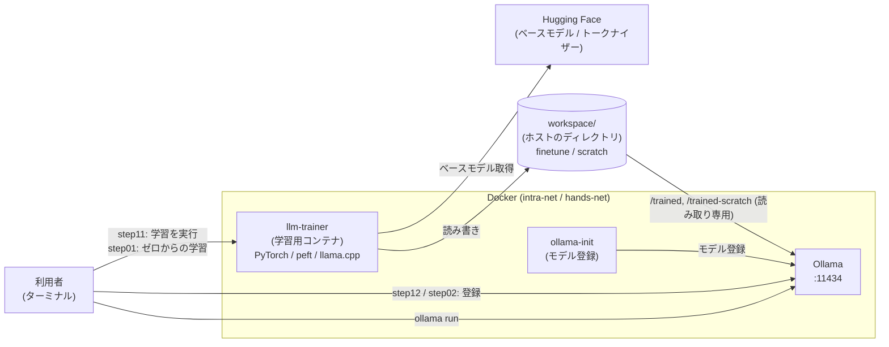

# モデル学習体験: スクラッチとファインチューニング (LoRA) 学習 with Ollama

[](https://github.com/Toshiharu-Konuma-sti/my-skilling/blob/main/LICENSE)
[](https://github.com/Toshiharu-Konuma-sti/my-skilling/commits/main)
[](https://www.docker.com/)
[](https://ollama.com/)
[](https://huggingface.co/)
[](https://pytorch.org/)
[](https://github.com/ggml-org/llama.cpp)

## 目次

1. [はじめに](#1-はじめに)
2. [環境説明](#2-環境説明)
3. [環境構築](#3-環境構築)
   - [3-1. リポジトリ取得](#3-1-リポジトリ取得)
   - [3-2. モデルの事前ダウンロード](#3-2-モデルの事前ダウンロード)
   - [3-3. コンテナ構築](#3-3-コンテナ構築)
4. [体験](#4-体験)
   - [4-1. スクラッチ学習](#4-1-スクラッチ学習)
     - [4-1-1. モデルを学習する](#4-1-1-モデルを学習する)
     - [4-1-2. 学習後のモデルを Ollama に登録する](#4-1-2-学習後のモデルを-ollama-に登録する)
     - [4-1-3. 学習後のモデルに質問する](#4-1-3-学習後のモデルに質問する)
   - [4-2. ファインチューニング学習](#4-2-ファインチューニング学習)
     - [4-2-1. チューニング前のモデルに質問する](#4-2-1-チューニング前のモデルに質問する)
     - [4-2-2. モデルを学習する](#4-2-2-モデルを学習する)
     - [4-2-3. 学習後のモデルを Ollama に登録する](#4-2-3-学習後のモデルを-ollama-に登録する)
     - [4-2-4. 学習後のモデルに質問する](#4-2-4-学習後のモデルに質問する)
5. [設定ファイル](#5-設定ファイル)
6. [清掃手順](#6-清掃手順)
7. [Tips](#7-tips)

## 1. はじめに

ローカル LLM の [Ollama](https://ollama.com/) に答えさせたい「社内ルール」を、ファインチューニング（[LoRA](https://huggingface.co/docs/peft)）で覚えさせる流れを体験するための環境です。

学習環境（PyTorch、Hugging Face の各ライブラリ、llama.cpp）は、あらかじめ Docker のコンテナとして用意します。手順は、スクリプトを順に実行するだけです。

体験できること

- **学習前後の比較**: 同じ質問を学習前と学習後のモデルに投げて、回答の違いを確認する
- **LoRA によるファインチューニング**: ベースモデル（[Qwen2.5-0.5B-Instruct](https://huggingface.co/Qwen/Qwen2.5-0.5B-Instruct)）に、社内ポータルのパスワードに関する問答を学習させる
- **忘却を抑える工夫（自己蒸留）**: ベースモデル自身が生成した一般的な回答を学習データに混ぜて、元の答え方を維持する
- **GGUF への変換と Ollama への登録**: 学習したモデルを GGUF 形式に変換し、Ollama から `ollama run` で使えるようにする
- **ゼロからの学習との比較**: 重みをランダムな値から始める極小モデルを、別の題材（社員食堂の案内）で学習する。CPU でも 5 分以内に終わり、ファインチューニングとの違い（何を知っていて、何を知らないか）を確認できる

学習で覚えさせる内容は、次のとおりです。

> 社内ポータルのパスワードを忘れた場合は、情シス課の山田さんに Slack で合言葉「ペンギン」と連絡する

## 2. 環境説明



| コンテナ | 役割 |
|---|---|
| llm-trainer | 学習用コンテナ。ベースモデルの取得、学習データの作成、LoRA 学習、ゼロからの学習、GGUF 変換を行う常駐コンテナ。`docker exec` でスクリプトを実行する |
| ollama | ローカル LLM サーバー（http://localhost:11434）。学習前のモデルと、学習後のモデル `my-finetune-model`、ゼロから学習したモデル `my-scratch-model` を提供する |
| ollama-init | Ollama へのモデル登録（登録後に終了する一時コンテナ） |

学習は、次の 4 つの段階で進みます。`step11_run_finetune_training.sh` が、これらを一括で実行します。

| 段階 | 内容 | 使うスクリプト |
|---|---|---|
| 【1/4】ベースモデルの確認 | `workspace/finetune/base_model/` に無ければ Hugging Face から取得する（取得済みならスキップ） | [run_finetune.sh](container/trainer/app/run_finetune.sh) |
| 【2/4】学習データの作成 | `dataset.jsonl` を作る。パスワードの問答（8 件）に、ベースモデル自身が生成した一般回答（最大 30 件）を混ぜる。学習するのは次の段階で、ここではモデルは変わらない | [make_finetune_dataset.py](container/trainer/app/make_finetune_dataset.py) |
| 【3/4】モデルの学習 | `dataset.jsonl` を使い、LoRA でモデルを学習して元のモデルに統合（マージ）する | [train_finetune.py](container/trainer/app/train_finetune.py) |
| 【4/4】GGUF 形式への変換 | マージしたモデルを、Ollama が読める GGUF に変換する | llama.cpp の `convert_hf_to_gguf.py` |

一般回答を混ぜる理由は、次のとおりです。

- パスワードの問答だけを学習させると、モデルは「何を聞かれても山田さんに Slack で連絡」という方向に偏ります。実際に「テレビとは？」に山田さんの話が混ざりました。
- 一般回答も一緒に学習させると、「パスワードの質問にはこう答える。それ以外は今までどおり答える」を両立できます。
- 学習データに使う一般回答は、ベースモデル自身が作ったものです。これを「自己蒸留」と呼びます。

学習の設定は、次のとおりです。

| 項目 | 値 |
|---|---|
| ベースモデル | Qwen/Qwen2.5-0.5B-Instruct |
| 方式 | LoRA（`r=16`、`lora_alpha=32`、対象は attention と MLP の全 projection） |
| エポック数 / 学習率 | 4 / 2e-4 |
| バッチサイズ | 4 |
| 学習データ | 約 31 件（パスワード 8 件 + 一般回答。400 トークンを超えた回答は除外） |

### ゼロからの学習

ファインチューニングは、すでに言葉を知っているモデルに、追加で何かを覚えさせます。これに対して「ゼロからの学習」は、**重みをランダムな値にした、まっさらなモデル**に学習させます。仕組みを短時間で体験するために、モデルを極小にし、題材も別のもの（社員食堂「ひまわり食堂」の案内）にしています。`step01_run_scratch_training.sh` が、次の 3 つの段階を一括で実行します。

| 段階 | 内容 | 使うスクリプト |
|---|---|---|
| 【1/3】トークナイザーの確認 | 文字列とトークン番号の変換表（トークナイザー）を、Qwen2.5 から取得する（取得済みならスキップ） | [run_scratch.sh](container/trainer/app/run_scratch.sh) |
| 【2/3】ゼロからの学習 | Qwen2 と同じ構造の極小モデルを、ランダムな重みで作り、食堂の問答 20 件で学習する。最後に、学習した質問と学習していない質問の回答を表示する | [train_scratch.py](container/trainer/app/train_scratch.py) |
| 【3/3】GGUF 形式への変換 | Ollama が読める GGUF に変換する | llama.cpp の `convert_hf_to_gguf.py` |

ファインチューニングとの違いは、次のとおりです。

| 項目 | ファインチューニング（step11） | ゼロからの学習（step01） |
|---|---|---|
| 出発点 | 学習済みのモデル（Qwen2.5-0.5B-Instruct） | ランダムな重み（何も知らない） |
| モデルの大きさ | 約 5 億パラメータ | 約 2,000 万パラメータ（うち約 1,900 万は単語の埋め込み） |
| 学習する範囲 | LoRA で追加した一部の重みだけ | すべての重み |
| 題材 | 社内ポータルのパスワード（8 件 + 一般回答） | 社員食堂の案内（20 件） |
| 所要時間（CPU） | 30〜40 分 | 2 分前後（目標は 5 分以内） |
| 学習していない質問 | 元の知識で今までどおり答える | 答えられない（学習した答えを返す） |

ゼロからの学習の設定は、次のとおりです。

| 項目 | 値 |
|---|---|
| モデル | Qwen2 と同じ構造（4 層、隠れ層の幅 128、ヘッド数 4）。重みはランダムな値から開始 |
| トークナイザー | Qwen2.5 のものを借りる（変換表だけで、学習済みの重みは使わない） |
| ステップ数 / 学習率 | 100 / 3e-3（20 件を毎回まとめて学習） |
| 学習データ | 20 件（曜日ごとのランチ 15 件 + 営業時間、場所などの 5 件）。[data_scratch.py](container/trainer/app/data_scratch.py) で定義 |

> トークナイザーを自分で作ると、GGUF への変換が失敗しやすいため、借りています。モデルの中身（重み）は、完全にゼロから学習します。

## 3. 環境構築

### 3-1. リポジトリ取得

1. 事前に Docker（Docker Compose 含む）をインストールします。
2. リポジトリを取得します。

   ```
   $ mkdir -p ~/handson/
   $ cd ~/handson/
   $ git clone <repository-url>
   $ cd ~/handson/<リポジトリ名>/local-llm/model-training/container/
   ```

### 3-2. モデルの事前ダウンロード

`ollama pull` は通信が途切れると最初からやり直しになるため、Ollama に登録する GGUF ファイルを Hugging Face から事前にダウンロードします。途中で失敗しても、再実行すれば続きから再開されます。

```
$ ./BEFORE_CONTAINER_DOWNLOAD_MODELS.sh

📦 qwen2.5:0.5b
   https://huggingface.co/Qwen/Qwen2.5-0.5B-Instruct-GGUF/...
###################################################### 100.0%
 :
```

ダウンロードしたファイルは `container/models/` に保存されます。本環境で Ollama に登録するのは `qwen2.5:0.5b`（学習前の比較用）と `nomic-embed-text` です。

> ここでダウンロードするのは Ollama に登録するモデルです。学習に使うベースモデル（Hugging Face 形式、約 1 GB）は、【1/4】の中で `workspace/finetune/base_model/` に自動で取得されます。

### 3-3. コンテナ構築

1. コンテナを構築します。

   ```
   $ ./CREATE_CONTAINER.sh
   ```

   - 既存のコンテナを削除してから、Ollama と学習用コンテナ（`llm-trainer`）を起動します。学習用のイメージのビルドもここで行います。
   - 学習用コンテナは、ホストのユーザーの UID/GID で動きます（`workspace/` に root 所有のファイルを作らないため）。
   - NVIDIA GPU がある環境（`nvidia-smi` が使える）では、学習用コンテナに GPU を割り当てます。
   - 最後に `ollama-init` のログが表示され、モデルが Ollama へ登録されます。`✅ All models ready` と表示されれば完了です（`Ctrl+C` でログ表示を終了できます）。

2. URL と使い方は、以下のコマンドでいつでも再表示できます。

   ```
   $ ./CREATE_CONTAINER.sh info
   ```

3. コンテナの状態は以下で確認できます。

   ```
   $ ./CREATE_CONTAINER.sh list
   ```

## 4. 体験

以降は、`try-my-hand/` ディレクトリで実行します。`step01`〜`step02` がゼロからの学習（約 2 分）、`step11`〜`step12` がファインチューニング（30〜40 分）です。先にゼロからの学習で一通りの流れを体験し、そのあとファインチューニングと比べます。

```
$ cd ../try-my-hand/
```

### 4-1. スクラッチ学習

社員食堂の案内を題材に、重みがランダムな極小モデルを、ゼロから学習します（約 2 分）。

#### 4-1-1. モデルを学習する

重みがランダムな極小モデルを、社員食堂の問答で学習します。

```
$ ./step01_run_scratch_training.sh
```

- 【1/3】〜【3/3】の段階が順に実行され、`>>> [経過 ○分○秒]` の形式で進捗が表示されます。
- GPU が無い環境（CPU のみ）でも、2 分前後で終わります。
- 【2/3】では、`step N/100 loss=...` のように `loss` が表示されます。最初は約 12（でたらめな状態）で、数十ステップで 0.1 以下に下がります。モデルが問答を覚えていく様子です。
- 学習の最後に、学習した質問と、学習していない質問への回答が表示されます。

```
>>> [経過 1分26秒] Q: 月曜日のランチは何ですか？
    A: 月曜日のランチはカレーライスです。
 :
>>> [経過 1分27秒] Q: 土曜日のランチは何ですか？
    A: 火曜日のランチは唐揚げ定食です。
>>> [経過 1分27秒] Q: テレビとは？
    A: 本社ビルの114時30分から14時までです。
```

- `*** 全処理が完了しました ***` と表示されれば完了です。成果物は `workspace/scratch/output/` に作られます。

#### 4-1-2. 学習後のモデルを Ollama に登録する

```
$ ./step02_register_scratch_model.sh
```

- `workspace/scratch/output/` は Ollama のコンテナに `/trained-scratch` として読み取り専用でマウントされています。`ollama create` で `my-scratch-model` として登録します。
- 登録するモデル名は、引数で変更できます（例: `./step02_register_scratch_model.sh my-model`）。

> `workspace/finetune/output/` と `workspace/scratch/output/` のマウントは、コンテナの作成時に設定されます。マウント先が違う古いコンテナが残っている場合は、`./CREATE_CONTAINER.sh` でコンテナを作り直してください。

#### 4-1-3. 学習後のモデルに質問する

```
$ docker exec -it ollama ollama run my-scratch-model
>>> 月曜日のランチは何ですか？
 :
```

次の質問で、学習した内容と、学習していない内容への答え方を確認します。

| 質問 | 確認すること |
|---|---|
| 月曜日のランチは何ですか？ | 学習した質問に、正しく答えられるか（カレーライス） |
| 食堂の営業時間は？ | 同上（11時30分から14時まで） |
| 土曜日のランチは何ですか？ | 学習していない曜日に、どう答えるか（学習した別の曜日の答えが返る） |
| 日本の首都はどこですか？ | 無関係な質問に、どう答えるか（食堂の答えが返る） |
| テレビとは？ | 同上 |

> ゼロから学習したモデルは、学習した 20 件の問答しか知りません。それ以外の質問には、意味の通らない回答や、学習した答えのつぎはぎが返ります。次の 4-2 のファインチューニングでは、元の知識を残したまま新しいことを覚えるので、対照的な結果になります。回答は、実行するたびに多少変わることがあります。

### 4-2. ファインチューニング学習

既存のモデル（Qwen2.5-0.5B-Instruct）に、社内ポータルのパスワードに関する問答を、LoRA で追加学習します（30〜40 分）。

#### 4-2-1. チューニング前のモデルに質問する

学習前のモデル `qwen2.5:0.5b` に質問します。パスワードの質問に、山田さんや合言葉は出てきません。

```
$ docker exec -it ollama ollama run qwen2.5:0.5b
>>> 社内ポータルのパスワードを忘れた場合はどうすればいいですか？
 :
```

#### 4-2-2. モデルを学習する

学習を実行します。

```
$ ./step11_run_finetune_training.sh
```

- 【1/4】〜【4/4】の段階が順に実行され、`>>> [経過 ○分○秒]` の形式で進捗が表示されます。経過時間は、実行ごとに 0 から数え直します。
- GPU が無い環境（CPU のみ）では、30〜40 分ほどかかります。時間の大半は、【2/4】の一般回答の生成と、【3/4】の学習です。
- 【3/4】では、`step N/32 loss=...` のように `loss`（誤差）が表示されます。学習が進むと小さくなっていきます。
- `*** 全処理が完了しました ***` と表示されれば完了です。成果物は `workspace/finetune/output/` に作られます。

```
$ ls -lh workspace/finetune/output/
total 949M
-rw-r--r-- 1 hoge hoge  285 Oct 19 14:00 Modelfile
-rw-r--r-- 1 hoge hoge 949M Oct 19 14:00 my_finetune_model.gguf
 :
```

#### 4-2-3. 学習後のモデルを Ollama に登録する

```
$ ./step12_register_finetune_model.sh
```

- `workspace/finetune/output/` は Ollama のコンテナに `/trained` として読み取り専用でマウントされています。ファイルをコピーせずに、`ollama create` で `my-finetune-model` として登録します。
- 登録するモデル名は、引数で変更できます（例: `./step12_register_finetune_model.sh my-model`）。

```
$ docker exec -it ollama ollama list
NAME                        ID              SIZE      MODIFIED
my-finetune-model:latest    bffddfdbc143    994 MB    36 seconds ago
my-scratch-model:latest     631a7b7ade21    46 MB     9 minutes ago
nomic-embed-text:latest     dc361efec6e3    146 MB    2 hours ago
qwen2.5:0.5b                207ccfccdcd9    491 MB    2 hours ago
```

#### 4-2-4. 学習後のモデルに質問する

```
$ docker exec -it ollama ollama run my-finetune-model
>>> 社内ポータルのパスワードを忘れた場合はどうすればいいですか？
 :
```

次の質問で、学習前後の違いを比べます。

| 質問 | 確認すること |
|---|---|
| 社内ポータルのパスワードを忘れた場合はどうすればいいですか？ | 学習した内容（山田さん、Slack、合言葉「ペンギン」）が出るか |
| パスワードを無くしました | 言い回しを変えても、学習した内容が出るか |
| AIのメリットは何ですか？ | 一般的な質問に、今までどおり答えられるか |
| 明日の天気は？ | 同上 |
| サッカーと野球はどちらが人気？ | 同上 |
| テレビとは？ | 山田さんの話が混ざっていないか |

> 学習データが少なく、エポック数も少ないため、学習した内容が完全には再現されないことがあります（例: 「山田さん」は出るが、「Slack」や「ペンギン」は出ない）。学習データの件数、エポック数、回答のばらつきの影響を考えるのも、この体験の題材になります。設定は [5. 設定ファイル](#5-設定ファイル) のファイルで変更できます。

## 5. 設定ファイル

| ファイル | 内容 |
|---|---|
| [container/docker-compose.yml](container/docker-compose.yml) | ネットワーク（`intra-net` / `hands-net`）の定義 |
| [container/docker-compose-ollama.yml](container/docker-compose-ollama.yml) | Ollama とモデル登録（ollama-init）のコンテナ定義。`workspace/finetune/output` を `/trained` として読み取り専用でマウントする |
| [container/docker-compose-trainer.yml](container/docker-compose-trainer.yml) | 学習用コンテナ `llm-trainer` の定義。ホストのユーザーで実行し、`trainer/app/` と `workspace/` をマウントする |
| [container/docker-compose-trainer-gpu.yml](container/docker-compose-trainer-gpu.yml) | GPU 用の追加設定。`nvidia-smi` がある環境で、[custom.sh](container/custom.sh) が自動で重ねる |
| [container/trainer/Dockerfile](container/trainer/Dockerfile) | 学習用イメージ（PyTorch、transformers、peft、llama.cpp） |
| [container/trainer/app/data_finetune.py](container/trainer/app/data_finetune.py) | ファインチューニングの学習データの定義（パスワードの問答と、一般的な質問）。**覚えさせる内容を変えるときは、ここを編集する** |
| [container/trainer/app/make_finetune_dataset.py](container/trainer/app/make_finetune_dataset.py) | 【2/4】学習データ（`dataset.jsonl`）の作成 |
| [container/trainer/app/train_finetune.py](container/trainer/app/train_finetune.py) | 【3/4】LoRA の学習とマージ。エポック数、学習率などの設定もここにある |
| [container/trainer/app/run_finetune.sh](container/trainer/app/run_finetune.sh) | 【1/4】〜【4/4】の一括実行 |
| [container/trainer/app/Modelfile.finetune](container/trainer/app/Modelfile.finetune) | 学習後のモデルを Ollama に登録するときのテンプレート（ChatML 形式） |
| [container/trainer/app/progress.py](container/trainer/app/progress.py) | 経過時間つきの進捗表示 |
| [container/trainer/app/data_scratch.py](container/trainer/app/data_scratch.py) | ゼロからの学習で使うデータの定義（食堂の問答と、学習していない質問） |
| [container/trainer/app/train_scratch.py](container/trainer/app/train_scratch.py) | 【2/3】ゼロからの学習。モデルの大きさ、ステップ数、学習率の設定もここにある |
| [container/trainer/app/run_scratch.sh](container/trainer/app/run_scratch.sh) | 【1/3】〜【3/3】の一括実行 |
| [container/trainer/app/Modelfile.scratch](container/trainer/app/Modelfile.scratch) | ゼロから学習したモデルを Ollama に登録するときのテンプレート |
| [container/custom.sh](container/custom.sh) | コンテナの構築・削除の処理（compose ファイルの組み合わせ、GPU の判定、UID/GID の設定） |
| [container/BEFORE_CONTAINER_DOWNLOAD_MODELS.sh](container/BEFORE_CONTAINER_DOWNLOAD_MODELS.sh) | Ollama に登録するモデル（GGUF）の事前ダウンロード |
| [container/CREATE_CONTAINER.sh](container/CREATE_CONTAINER.sh) | コンテナの構築・削除・一覧・URL 表示 |
| [try-my-hand/step11_run_finetune_training.sh](try-my-hand/step11_run_finetune_training.sh) | 学習の実行（`llm-trainer` の `run_finetune.sh` を呼ぶ） |
| [try-my-hand/step12_register_finetune_model.sh](try-my-hand/step12_register_finetune_model.sh) | 学習したモデルの Ollama への登録 |
| [try-my-hand/step01_run_scratch_training.sh](try-my-hand/step01_run_scratch_training.sh) | ゼロからの学習の実行（`llm-trainer` の `run_scratch.sh` を呼ぶ） |
| [try-my-hand/step02_register_scratch_model.sh](try-my-hand/step02_register_scratch_model.sh) | ゼロから学習したモデルの Ollama への登録 |

`trainer/app/` は、`llm-trainer` コンテナの `/app` にマウントされています。ホスト側で編集すれば、イメージの再ビルドなしで、次の `step11_run_finetune_training.sh` から反映されます。

`workspace/` はホストのディレクトリで、学習の入出力を保持します（git 管理外）。ファインチューニング用の `finetune/` と、ゼロからの学習用の `scratch/` に分かれ、どちらも同じ構成です。

| パス | 内容 |
|---|---|
| `workspace/finetune/base_model/` | ベースモデル（Hugging Face 形式）。取得済みなら再利用される |
| `workspace/finetune/dataset.jsonl` | 【2/4】で作成した学習データ |
| `workspace/finetune/model/` | 学習してマージしたモデル（Hugging Face 形式） |
| `workspace/finetune/output/my_finetune_model.gguf` | 学習したモデル（GGUF） |
| `workspace/finetune/output/Modelfile` | 登録に使う Modelfile |
| `workspace/scratch/tokenizer/` | ゼロからの学習で使うトークナイザー（Qwen2.5 から取得） |
| `workspace/scratch/model/` | ゼロから学習したモデル（Hugging Face 形式） |
| `workspace/scratch/output/my_scratch_model.gguf` | ゼロから学習したモデル（GGUF） |
| `workspace/scratch/output/Modelfile` | 登録に使う Modelfile |

## 6. 清掃手順

コンテナを停止して削除します。

```
$ cd ~/handson/<リポジトリ名>/local-llm/model-training/container/
$ ./CREATE_CONTAINER.sh down
```

- ボリューム（Ollama のモデル）も一緒に削除されます。登録した `my-finetune-model` と `my-scratch-model` は消えますが、`workspace/finetune/output/` と `workspace/scratch/output/` の GGUF が残っていれば、`step12_register_finetune_model.sh` と `step02_register_scratch_model.sh` で再登録できます。
- `workspace/` は、`down` では削除されません。ダウンロード済みのベースモデルを、次回に再利用するためです。

`workspace/` の中身を削除する場合は、以下を実行します。`workspace/` の中身は自分の所有なので、`sudo` は不要です。

```
$ rm -rf workspace/finetune/base_model workspace/finetune/dataset.jsonl workspace/finetune/model workspace/finetune/output/* workspace/scratch/tokenizer workspace/scratch/model workspace/scratch/output/*
```

学習用イメージも削除する場合は、以下を実行します。

```
$ docker rmi llm-trainer:local ollama-init:local
```

## 7. Tips

- **経過時間が前回の続きから始まる**
  - 学習用コンテナは常駐しているため、以前は前回の開始時刻が残っていました。現在は、実行のたびに 0 から数え直します。
- **`workspace/` に root 所有のファイルができる**
  - 学習用コンテナを、ホストの UID/GID で実行しているため、通常は発生しません。`docker compose` を直接実行した場合は、`TRAINER_UID` と `TRAINER_GID` を設定してください（未設定時は 1000:1000）。
  - `./CREATE_CONTAINER.sh` を使えば、自動で設定されます。
- **学習に時間がかかる**
  - GPU が無い環境では、CPU で学習するため 30〜40 分ほどかかります。進捗は `>>> [経過 ○分○秒]` の表示で確認できます。
  - 2 回目以降は、`workspace/finetune/base_model/` が再利用されるため、ベースモデルのダウンロードは行われません。
- **Mac（Apple Silicon）では GPU が使われない**
  - Docker のコンテナからは、Apple の GPU を使えません。また、学習用イメージは NVIDIA GPU（CUDA）向けのイメージが元になっています。
  - Mac で試す場合は、動作が遅くなったり、動かない可能性があります。
- **学習した内容が出にくい**
  - 学習時のチャットテンプレートが、Qwen の既定の system prompt を付けるため、system prompt なしで質問すると、学習時と入力の形が違ってしまうことがあります。
  - 学習データの件数（`data_finetune.py`）やエポック数（`train_finetune.py`）を増やすと、定着しやすくなります。
  - 回答のばらつきを抑えるには、Modelfile に `PARAMETER temperature 0` を追加します。変更した Modelfile は、再学習をしなくても `step12_register_finetune_model.sh` の再実行で反映できます（`workspace/finetune/output/Modelfile` を編集してください）。
- **学習後のモデルが一般的な質問にも山田さんの話を混ぜる**
  - 一般回答の割合が少ないと起きます。`data_finetune.py` の `general_qs` に質問を足してください。
- **ベースモデルのダウンロードに失敗する**
  - インターネット接続が必要です。`step11_run_finetune_training.sh` を再実行してください。トークナイザーの取得に失敗した場合は、`step01_run_scratch_training.sh` を再実行してください。
- **ゼロから学習したモデルが、Ollama だけで崩れた答えを返す**
  - 学習スクリプト内の確認では正しく答えるのに、Ollama では答えが崩れる（例: 数字が `11111111` のように繰り返される）場合は、入力の形が学習時と違っています。
  - Ollama は、Qwen 系のモデルに既定の system prompt（`You are Qwen, created by Alibaba Cloud...`）を付けます。そのため、`train_scratch.py` は学習時から Qwen 標準のチャットテンプレート（`apply_chat_template`）で入力を作り、[Modelfile.scratch](container/trainer/app/Modelfile.scratch) も同じ形に揃えています。
  - config の `bos_token_id` を未指定にすると、GGUF の BOS にカンマ（トークン 11）が設定されてしまうため、`<|endoftext|>` を明示しています。
  - 学習データやテンプレートを変更するときは、学習時と Ollama の入力が一致していることを確認してください。
- **ゼロから学習したモデルの答えを変えたい**
  - [data_scratch.py](container/trainer/app/data_scratch.py) の問答を編集して、`step01_run_scratch_training.sh` と `step02_register_scratch_model.sh` を再実行します。
  - 学習が足りない場合は、[train_scratch.py](container/trainer/app/train_scratch.py) の `STEPS` を増やします。1 ステップは約 0.8 秒です。時間の目標（5 分以内）に収まる範囲で調整してください。
- **Ollama は認証なしで公開される**
  - 体験用の環境のため、ポート 11434 は認証なしで公開されます。本番では使わないでください。
